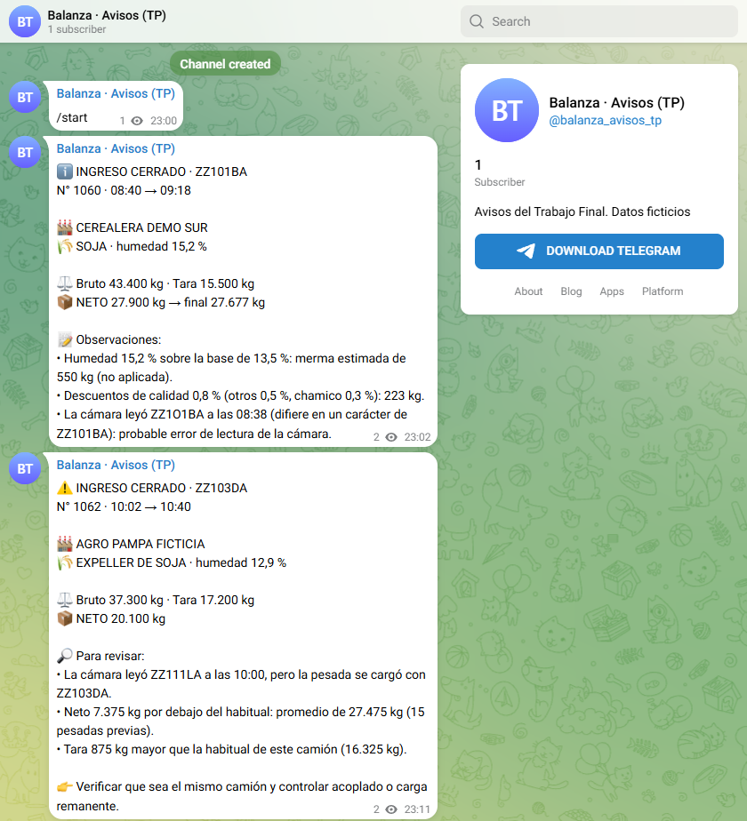
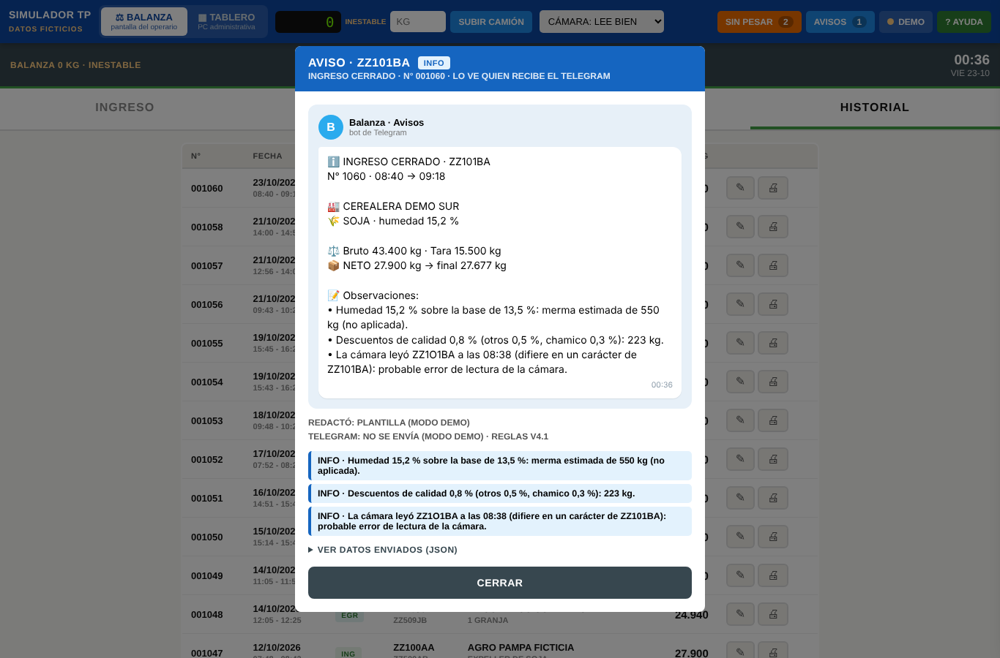
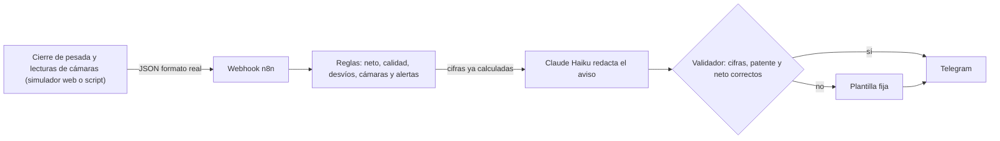
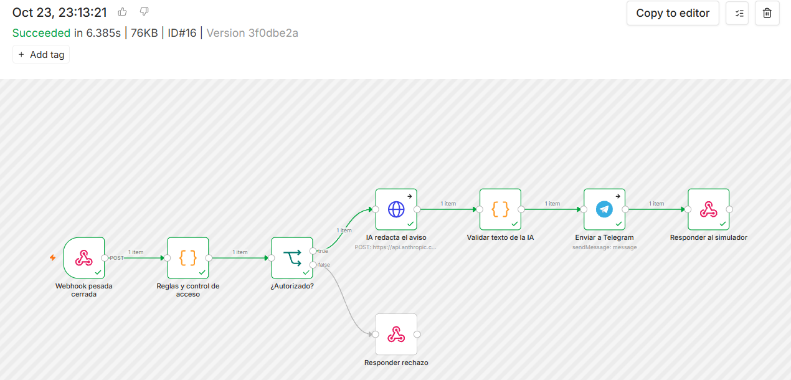

# Aviso inteligente de pesada cerrada

**Trabajo Final Integrador · Diplomatura en IA Aplicada a Entornos Digitales de Gestión (FCE-UBA, cohorte 2026)**

Cuando un camión termina de pesarse en la balanza de una planta de alimento balanceado, este proyecto manda un **aviso por Telegram** a las personas que tienen que enterarse: administración, calidad y compras. El aviso no es una notificación genérica de "se cerró una pesada". Calcula el neto, la merma por humedad y los descuentos de calidad. Compara contra lo habitual de ese proveedor y de ese camión, y **cruza la pesada con las cámaras de patentes**. Después usa **IA generativa para redactar un mensaje claro y priorizado**. Si algo no cierra, dice qué revisar. También avisa si un camión pasó por la cámara y nunca se pesó.

> ⚠️ **Todos los datos de este repositorio son ficticios.** El proyecto se basa en un sistema de pesadas real que funciona en una planta, pero ese sistema **no** está incluido. Acá hay una simulación **fiel a la operación real**: mismo formato de datos, mismas reglas de calidad y mismo tratamiento de las cámaras. Permite probar la idea de punta a punta.

**Probalo:** [simulador online](https://patricio15623.github.io/tp-pesadas-ia/simulador/)

**Avisos reales:** [canal público de Telegram](https://t.me/s/balanza_avisos_tp). Son avisos generados con Claude y enviados por el bot, y se pueden ver desde el navegador sin cuenta de Telegram.





---

## ¿Qué problema resuelve?

En una balanza se cierran decenas de pesadas por día. Hoy, para enterarse de algo raro, alguien tiene que mirar la pantalla o esperar al reporte del día siguiente. Por ejemplo: humedad alta, un camión que trajo mucho menos que de costumbre, una tara que no coincide, una patente cargada que no es la que leyó la cámara o un camión que entró y no pasó por la balanza. Cuando se detecta, el camión ya se fue.

El aviso llega **en el momento**, al celular, y **jerarquizado**:

| Nivel | Ejemplo |
|---|---|
| ✅ NORMAL | Ingreso de maíz, neto 29.600 kg, sin observaciones. |
| ℹ️ INFO | Humedad 15,2 % sobre la base de 13,5 %: merma estimada de 550 kg. Descuentos de calidad 0,8 %. La cámara leyó ZZ1O1BA (probable error de lectura). |
| ⚠️ ATENCIÓN | Neto 7.375 kg por debajo del promedio del proveedor, tara 875 kg mayor que la habitual y **la cámara leyó otra patente**. |
| ⚠️ ATENCIÓN | **Camión sin pesar:** la cámara registró ZZ110KA a las 07:20 y no tiene pesada. |
| 🛑 CRÍTICO | Humedad 18,6 %, por encima del límite de recepción de 18 %. |

## Cómo funciona



Así se ve en n8n.cloud una ejecución real, con todos los pasos completados:



**Criterio central del diseño: la IA redacta, pero no hace cuentas.**

- Los cálculos y las alertas los hace código común (`simulador/reglas.js`), con pruebas automáticas.
- La IA recibe las cifras ya escritas y solo arma un mensaje legible.
- Antes de enviarlo, un validador controla que la IA no haya inventado ningún número y que estén la patente y el neto. Si algo falla, sale la plantilla fija: **el aviso llega siempre**.

## Cómo se usa

### Opción A: sin instalar nada (modo demo)

Abrir el [simulador online](https://patricio15623.github.io/tp-pesadas-ia/simulador/), o `simulador/index.html` con doble clic. Reproduce las **dos pantallas del sistema real**, con el mismo aspecto y el mismo flujo de trabajo:

- **Balanza** (la usa el operario): pestañas **INGRESO**, **EGRESO**, **EN PLANTA** e **HISTORIAL**, comprobante original y duplicado, rechazo y corrección de datos.
- **Tablero** (PC administrativa): ingresos y egresos con filtros y totales, camiones en planta, rechazados, capturas de patentes, logs, control de calidad y parámetros.

Todo lo propio del TP está en la **barra azul de arriba**, separada de la interfaz real: cambiar entre **BALANZA** y **TABLERO**, la balanza simulada, cómo lee la cámara, los camiones **SIN PESAR**, los **AVISOS** enviados, el modo (**DEMO** o **N8N ✓**) y una **AYUDA** de tres pasos que aparece la primera vez.

**Una pesada completa, como en la planta:**

1. **INGRESO:** cargar patente, proveedor, avícola y producto, y opcionalmente la calidad (humedad, descuentos, merma). En la barra azul, la **balanza simulada** reemplaza al indicador: poner el peso y tocar **SUBIR CAMIÓN**; el bruto se completa solo cuando la lectura queda estable (también se puede tipear). Tocar **REGISTRAR INGRESO**.
2. **EN PLANTA:** el camión queda abierto. Tocar **REGISTRAR TARA** y pesar el camión vacío. En el **EGRESO** es al revés: entra vacío y se usa **AGREGAR CARGA**, una vez por granja, con el peso que se acumula.
3. **CERRAR Y EMITIR:** se cierra la operación y aparece el **aviso** tal como llegaría a Telegram, con las alertas detectadas. Desde **HISTORIAL** se imprime el comprobante.

**Casos de ejemplo:** en **EN PLANTA** ya hay 6 camiones cargados, cada uno con un caso distinto (en estos el camión "sube" solo a la balanza con el peso previsto):
- normal;
- humedad y descuentos;
- humedad sobre el límite;
- neto, tara y patente que no coinciden;
- egreso a tres granjas;
- permanencia larga.

**Cámaras:** en la barra azul se elige cómo lee la cámara de entrada la patente al registrar el ingreso: bien, con un error (0 por O), otra patente o sin leer. Las lecturas se ven en **Tablero → Patentes**. Si un camión pasó por la cámara y no se pesó, aparece en **SIN PESAR**, con **AVISAR**.

**Parámetros de calidad:** en **Tablero → Parámetros** (humedad base y límite de recepción; vacío = sin aviso). Cada cambio pide un motivo y queda en los logs.

En modo demo el aviso lo arma la plantilla fija, con las mismas reglas.

### Opción B: con IA y Telegram reales

1. Configurar n8n.cloud siguiendo [`n8n/README.md`](n8n/README.md): importar el flujo y cargar la API key de Anthropic, el bot de Telegram y la clave.
2. En el simulador, tocar **DEMO** en la barra azul → **Conexión con n8n**, pegar la URL del webhook y la clave. El botón pasa a decir **N8N ✓**.

   También se puede compartir un link ya configurado: `.../simulador/?webhook=URL&clave=CLAVE`.
3. Cada cierre se envía a n8n: Claude redacta, el validador controla y el mensaje llega al grupo de Telegram.

### Opción C: desde la terminal

```bash
cp .env.example .env              # completar WEBHOOK_URL y CLAVE
python scripts/simular_cierre.py              # lista los camiones y las cámaras
python scripts/simular_cierre.py 2 --humedad 17.5 --aplicar-merma
python scripts/simular_cierre.py --sin-pesar   # camión que pasó por la cámara y no se pesó
python scripts/simular_cierre.py 3 --solo-ver   # ver el JSON sin enviar
```

## Fiel a la operación real

La simulación copia **cómo funciona y cómo se ve** la pantalla de la balanza, pero no su código ni sus datos:

| Aspecto | Cómo se simula |
|---|---|
| Pesada de ingreso | Entra lleno (`peso_inicial` = bruto) y sale vacío (`peso_final` = tara). |
| Pesada de egreso | Entra vacío y carga para varias granjas. Cada carga se pesa sobre la anterior y su neto es la diferencia. |
| Calidad | Merma = (H − base) / (100 − base). Es **informativa** salvo que se aplique. Descuentos: otros % + olor, amohosado, chamico, bichos, volátil. |
| Parámetros | Humedad base por producto, buscando la palabra en el nombre (“EXPELLER DE SOJA” → EXPELLER). Límite de recepción vacío = sin aviso. |
| Cámaras | Cámaras ENTRADA y SALIDA. La otra cámara dentro de 5 min es el mismo paso. La misma cámara dentro de 20 s es una repetida y se ignora. La misma cámara más tarde es otra pasada (ida y vuelta). |
| Textos | Mayúsculas, sin tildes, conservando la Ñ. Patentes sin espacios ni guiones. |
| Pantallas | Las dos del sistema real, con el mismo aspecto: balanza (ingreso o egreso → en planta → registrar tara o agregar carga → cerrar y emitir → comprobante) y tablero administrativo. La lectura de peso del indicador se reemplaza por una balanza simulada. |

El formato del evento está en [`docs/formato_evento.md`](docs/formato_evento.md). El sistema real podría enviarlo sin adaptaciones.

## Herramientas de IA usadas

| Parte | Herramienta | Para qué |
|---|---|---|
| Redacción del aviso (en ejecución) | **Claude Haiku** (`claude-haiku-5-5`, API de Anthropic) | Convierte cifras y alertas en un mensaje claro para Telegram. Es un modelo chico y rápido: cada aviso cuesta fracciones de centavo de dólar. |
| Alternativa de redacción | **Google Gemini** (`gemini-2.5-flash`, API gratuita) | Flujo alternativo (`n8n/flujo_aviso_pesada_gemini.json`) por si se termina el saldo de la API. Mismas reglas y validador. |
| Orquestación | **n8n** (n8n.cloud) | Webhook → reglas → IA → validación → Telegram, sin servidor propio. |
| Desarrollo (vibe coding) | **Claude** (Anthropic) | Asistente de programación: simulador, reglas, pruebas, flujo de n8n y documentación, dirigido y revisado por el autor. |
| Mensajería | **Telegram Bot API** | Canal de entrega del aviso. |

## Estructura del repositorio

```
├── simulador/            Simulador web (HTML + JS, sin dependencias)
│   ├── index.html
│   ├── reglas.js         ÚNICA fuente de reglas, cámaras, prompt y validador
│   ├── simulacion.js     Cierre de operaciones (formato del sistema real)
│   └── datos.js          Datos ficticios para el navegador
├── n8n/
│   ├── flujo_aviso_pesada.json         Flujo para importar en n8n (IA: Claude)
│   ├── flujo_aviso_pesada_gemini.json  Alternativa con Gemini (gratuita)
│   └── README.md                 Configuración paso a paso
├── datos/pesadas_ficticias.json  Historial, camiones en planta y lecturas de cámaras (ficticios)
├── prompts/README.md     Evolución del prompt y registro de pruebas
├── scripts/
│   ├── generar_datos.py      Genera los datos ficticios (reproducible)
│   ├── armar_flujo.py        Arma el flujo de n8n desde reglas.js
│   ├── simular_cierre.py     Envía cierres al webhook desde la terminal
│   ├── servidor_simulado.py  IA y Telegram simulados para probar sin internet
│   └── test_reglas.js        Pruebas automáticas (node scripts/test_reglas.js)
├── docs/
│   ├── formato_evento.md Formato del JSON, respuesta y alertas posibles
│   ├── pruebas.md        Qué se probó y con qué resultado
│   └── capturas/
└── informe/              Informe del trabajo (PDF)
```

## Seguridad y privacidad

- **Datos ficticios:** proveedores, avícolas, choferes y patentes (serie `ZZ`, no emitida) son inventados y se generan con `scripts/generar_datos.py`.
- **Sin secretos en el repo:** el token del bot, la API key de Anthropic y la clave de acceso se cargan como credenciales en n8n. El `.gitignore` excluye `.env`.
- **Webhook protegido:** sin la clave correcta responde 401 y no llama a la IA, así nadie puede gastar la cuota ni escribir en el grupo.
- **Control humano:** el aviso sugiere revisar, pero nunca aprueba ni rechaza un camión. Esa decisión es siempre de una persona.

## Versiones

El historial de commits muestra la evolución del trabajo:

- **v1:** reglas con pruebas y simulador en modo demo.
- **v2:** flujo de n8n con IA, validación y Telegram, probado de punta a punta con servicios simulados.
- **v3:** documentación e informe.
- **v4:** simulación fiel al sistema real. Mismo formato de operación (`peso_inicial`, `peso_final`, `neto_total`, `cargas`), egreso a varias granjas, descuentos de calidad, merma informativa por defecto y límite de recepción vacío = sin aviso. Se suman las cámaras de patentes con las reglas de la planta: unificar en 5 min, repetidas en 20 s, ida y vuelta.

---

*Proyecto académico. Autor: Patricio. El sistema de pesadas en el que se basa es de su autoría y no forma parte de este repositorio.*
